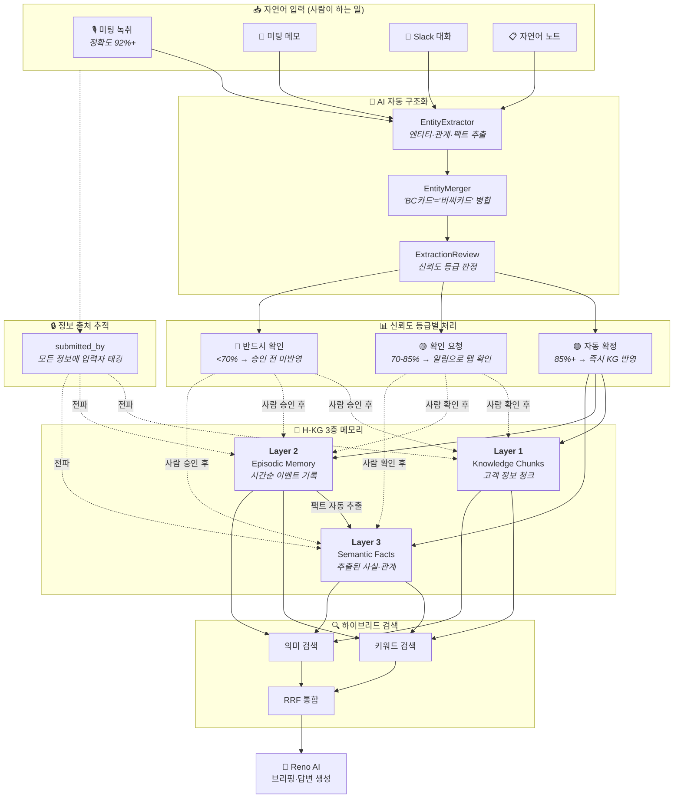
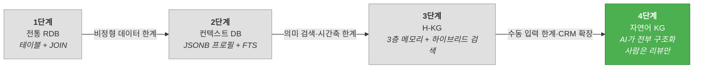
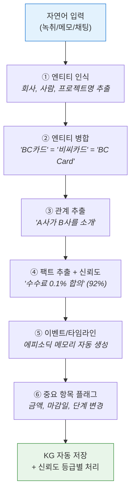
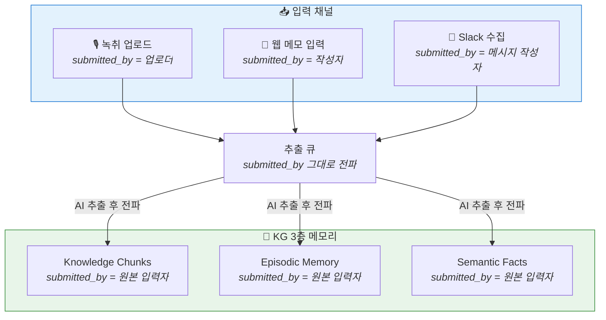
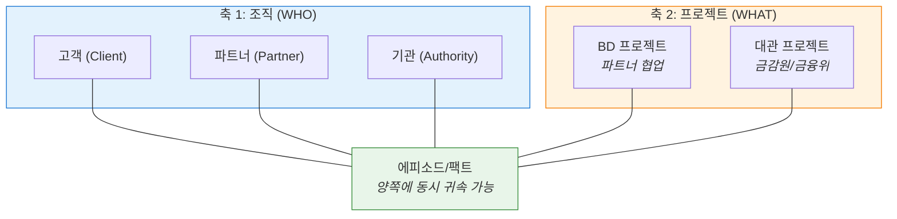
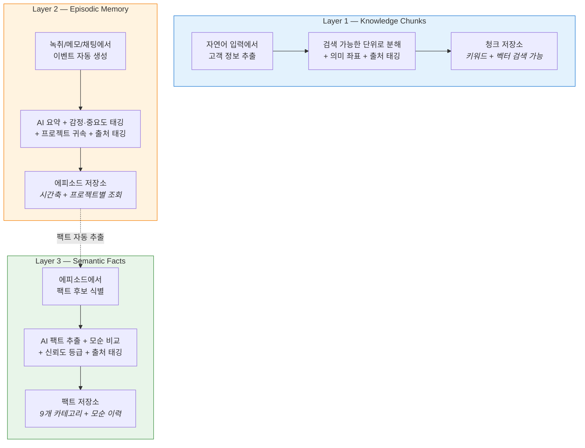
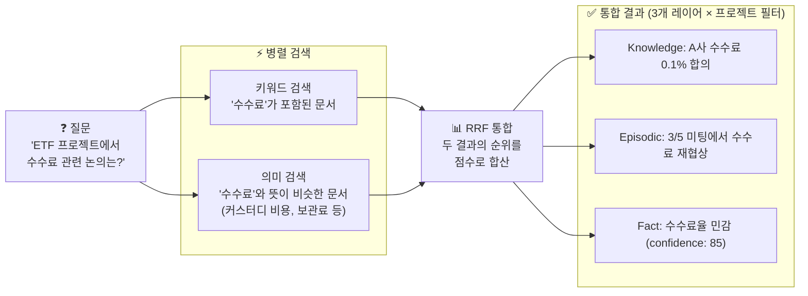
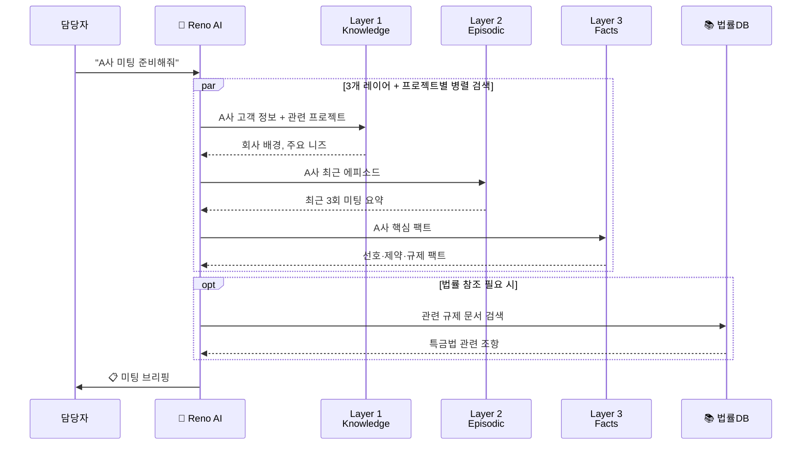
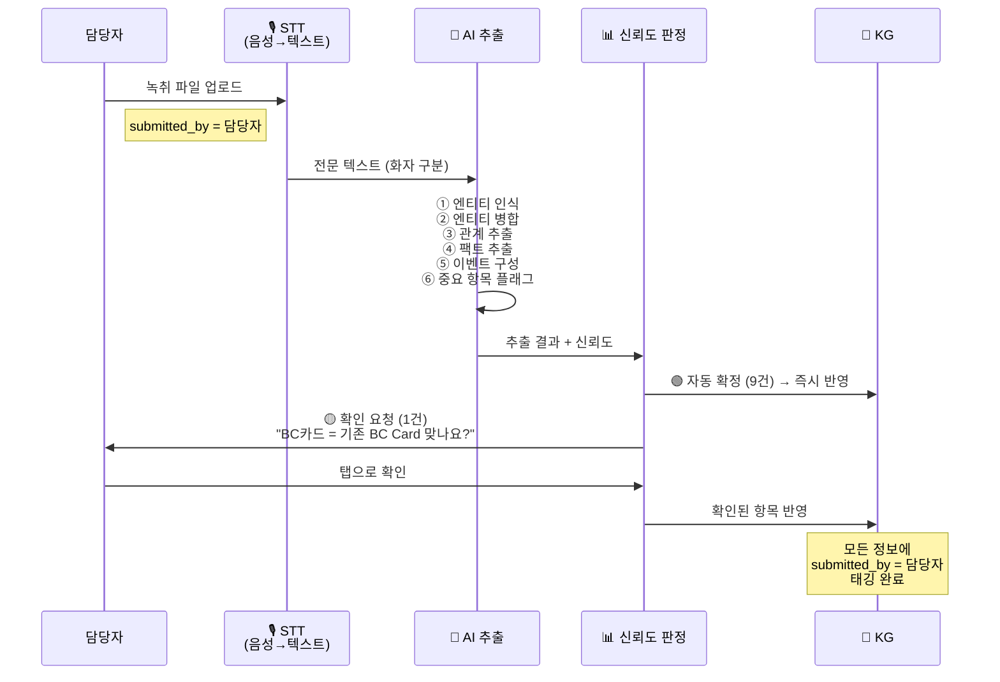

# 세일즈허브 고객 자료구조의 단계적 개선

**경과보고서** | 2026. 03. 16. | 세일즈허브 개발팀

---

## 1. Executive Summary — 4단계 자연어 기반 KG란 무엇인가

### 한 줄 요약

> 사람이 폼을 채우지 않는다. **녹취·메모·채팅만 입력하면 AI가 모든 고객 정보를 자동 구조화**하고, 사실과 관계의 그래프(KG)로 관리하는 시스템.

기존 1단계(관계형 DB) → 2단계(컨텍스트 DB) → 3단계(H-KG)를 거쳐, 세일즈허브는 현재 **4단계 — 자연어 기반 KG**로 전환 중입니다.

| 단계 | 핵심 변화 |
|:----:|----------|
| 1~2단계 | 사람이 직접 데이터를 입력하고, 시스템이 저장 |
| 3단계 (H-KG) | 사람이 폼 입력 + AI가 KG를 보조적으로 축적 |
| **4단계 (자연어 KG)** | **사람은 자연어만 입력, AI가 전부 구조화, 사람은 리뷰만** |

4단계의 핵심 가치 다섯 가지:

| 핵심 가치 | 설명 |
|-----------|------|
| **폼 입력 제로** | 녹취 업로드, 메모, 채팅만으로 고객 정보 자동 축적 |
| **자동 구조화** | AI가 엔티티·관계·팩트·타임라인을 자동 추출 |
| **신뢰도 등급제** | 추출 결과를 🟢🟡🔴 3등급으로 분류, 위험 항목만 사람이 확인 |
| **정보 출처 추적** | 모든 정보에 "누가 올린 것인지" 100% 추적 — 접근 제어의 핵심 기반 |
| **3대 관계 통합 관리** | 고객(Client), 파트너(Partner), 프로젝트(BD/대관)를 하나의 KG에서 관리 |

아래 다이어그램은 4단계의 전체 구조를 보여줍니다.



---

## 2. 1→2→3→4단계 진화 경로

이전 보고에서 공유한 1~2단계를 간략히 환기하고, 3단계를 거쳐 4단계까지의 진화를 정리합니다.



### 1단계: 전통 RDB

고객(customers), 미팅(meetings), 메모(memos) 등을 정규화된 테이블에 저장. 정확한 필드 검색에 강하지만, "이 고객이 규제 리스크에 민감한 이유"처럼 **맥락을 묻는 질문**에는 대응 불가.

### 2단계: 컨텍스트 DB

테이블 위에 고객별 프로필(구조화된 JSON)과 키워드 검색(FTS)을 추가. "보관 수수료"를 검색하면 해당 키워드가 포함된 문서를 찾을 수 있게 됨.

### 3단계: H-KG (이전 보고서에서 상세 공유)

3층 메모리(Knowledge Chunks + Episodic Memory + Semantic Facts)와 하이브리드 검색(RRF)을 도입. 의미 검색, 시간축 추적, 모순 감지가 가능해짐.

### 3단계에서 남은 한계

| # | 한계 | 영향 |
|---|------|------|
| ① | **사람이 여전히 폼을 채움** | 고객 기본정보(회사명, 단계, 담당자)는 수동 입력. KG는 보조 역할에 그침 |
| ② | **CRM 프로세스 관리 부재** | 딜 진행, 접촉 빈도, 파이프라인 이력이 KG에 없음 |
| ③ | **3대 관계 유형 미구분** | 고객, 파트너, 금융당국이 모두 같은 테이블에 혼재 |
| ④ | **프로젝트에 KG 없음** | BD 협업, 대관 프로젝트의 에피소드·팩트 축적 불가 |
| ⑤ | **정보 출처 불명** | 누가 올린 정보인지 추적 불가 → 권한 분리의 기반 부재 |

이 다섯 가지 한계가 4단계 전환의 직접적인 이유입니다.

---

## 3. 4단계의 핵심 — 자연어 입력 + AI 자동 구조화

### 아키텍처 전환

```
3단계: 사람 → 폼 입력 → RDB → AI가 KG 축적 (보조)
4단계: 사람 → 자연어 → AI가 전부 구조화 → KG가 곧 DB → 사람은 리뷰만
```

사람이 하는 일은 **녹취 파일 업로드, 메모 작성, Slack 대화** — 이것뿐입니다. 나머지는 AI가 처리합니다.

### 입력 소스와 정확도

| 순위 | 소스 | AI 추출 정확도 | 비고 |
|:----:|------|:-------------:|------|
| 1 | 🎙️ 미팅 녹취 전문 | **92%+** | STT → 화자 구분 → 맥락 파악 최적 |
| 2 | 📝 상세 미팅 메모 | 85% | 담당자가 정리한 요약 |
| 3 | 💬 Slack / 채팅 | 80% | 실시간 대화에서 자동 수집 |
| 4 | 📋 한줄 자연어 노트 | 70% | 간단한 메모 |

**녹취 전문이 정확도를 높이는 이유:**

메모는 "담당자가 중요하다고 판단한 것"만 포함합니다. 녹취 전문은 본인이 빠뜨린 정보까지 포함합니다.

| 항목 | 메모 기반 | 녹취 전문 기반 |
|------|:---------:|:-------------:|
| 합의 vs 제안 구분 | 65% | **93%+** |
| 금액/수수료 정확도 | 70% | **92%+** |
| 참석자 발언 귀속 | 불가 | **95%+** |
| 숨은 맥락 포착 | 유실 | **포착 가능** |

### AI 구조화 파이프라인

자연어 입력이 들어오면 AI가 6단계로 자동 구조화합니다:



### 신뢰도 등급제 — 위험한 것만 사람이 확인

AI가 추출한 결과를 신뢰도에 따라 3등급으로 자동 분류합니다.

| 등급 | 신뢰도 | 처리 | 해당 항목 |
|:----:|:------:|------|----------|
| 🟢 | 85%+ | **자동 확정** — 사람 확인 불필요 | 미팅 요약, 감정, 요구조건, 관계, 참석자 |
| 🟡 | 70-85% | **확인 요청** — 알림으로 탭 확인 | 엔티티 병합, 팩트 분류 |
| 🔴 | <70% | **반드시 확인** — 승인 전 미반영 | 금액, 마감일, 파이프라인 단계 |

**녹취 전문 있을 때**: 🟢 9개 / 🟡 1개 / 🔴 거의 없음
**메모만 있을 때**: 🟢 6개 / 🟡 2개 / 🔴 2개

사용자 체감: 미팅 녹취 올리면 → AI가 10개 항목 추출 → 7개 자동 저장 → 2개 "맞나요?" 탭 확인 → 1개 금액 확인. **폼 입력 제로.**

---

## 4. 정보 출처 추적 — KG 전체의 핵심 기반

4단계에서 새로 도입된 가장 중요한 인프라 요소입니다. KG에 저장되는 **모든 정보는 "누가 올린 것인지" 100% 추적**됩니다.

### 왜 중요한가

| 이유 | 설명 |
|------|------|
| **권한 분리의 기반** | 조회 권한은 "누가 올린 정보인가"에 따라 결정됨 |
| **책임 소재** | AI가 잘못 추출한 팩트 → 원본 입력자를 추적하여 검증 요청 |
| **감사 추적** | 규제 관련 정보는 "누가 언제 입력했는지"가 감사 대상 |
| **신뢰도 보정** | 담당자 직접 입력 vs 간접 전달 — 입력자에 따라 신뢰도 차등 |

### 추적 흐름



**핵심 원칙**: AI는 도구일 뿐, 정보의 출처는 항상 사람입니다. AI가 추출한 팩트도 원본 입력자가 출처로 기록됩니다.

### 접근 제어와의 연동

기존 3단계의 접근 제어(그룹 기반 ACL + 기밀 등급)에 **입력자 기반 필터**가 3번째 축으로 추가됩니다:

```
조회 시 3단계 접근 판정:

  ① 그룹 ACL  — 해당 고객/프로젝트에 접근 가능한 그룹인가?
  ② 기밀 등급 — public/confidential 중 어디까지 볼 수 있는가?
  ③ 입력자 팀 — 입력자가 속한 팀의 정보를 볼 권한이 있는가?  ← 4단계 추가
```

| 조회자 역할 | 접근 범위 |
|-------------|----------|
| MASTER | 전체 KG 조회 |
| ADMIN | 자기 팀 + 하위 팀 정보 |
| MANAGER | 자기 팀 정보 |
| USER | 본인 입력 + 팀 공유 정보 |

---

## 5. 3대 추적 대상 — 고객, 파트너, 프로젝트

3단계에서는 모든 거래처가 하나의 `customers` 테이블에 혼재되어 있었습니다. 4단계에서는 **3대 관계 유형을 명확히 구분**합니다.

### 5-1. 고객 (Client)

WB Prime 서비스 이용사. 교환, 커스터디 등 딜 기반 서비스.

추적: 온보딩 절차, 딜 진행, 계약 조건, 요구사항, 미팅 이력

### 5-2. 파트너 (Partner)

WB Korea & Global 협업사. 이니셜 미팅부터 프로젝트 단위 협업.

추적: 이니셜 미팅, 협업 프로젝트, 관계 발전 이력

### 5-3. 프로젝트 (Project)

두 가지 유형:
- **BD 프로젝트** — 파트너 협업 프로젝트
- **대관 프로젝트** — 금감원, 금융위 대관 (문서 제출/수신 추적)

### 5-4. 하나의 KG, 두 개의 축



예시: "3월 5일 A사 미팅"은 A사(고객) + ETF 프로젝트(BD) 양쪽에 연결됩니다. 어느 쪽에서 검색하든 동일한 에피소드와 팩트가 나옵니다.

---

## 6. H-KG 3층 메모리 (3단계 유지, 4단계에서 확장)

3단계에서 구축한 3층 메모리 구조는 4단계에서도 그대로 유지됩니다. 변경된 점은 **채우는 방식**입니다.

```
3단계: 사람이 폼/회의록 등록 → 시스템이 KG에 저장
4단계: 사람이 자연어 입력 → AI가 추출 → 신뢰도별 KG 저장 + 출처 태깅
```



### 4단계에서 추가된 점

| 변경 | 3단계 | 4단계 |
|------|-------|-------|
| 입력 방식 | 사람이 등록 | AI가 자연어에서 자동 추출 |
| 프로젝트 연결 | 없음 | 모든 레이어에 project_id |
| 정보 출처 | created_by (부분적) | **submitted_by 전 레이어 필수** |
| 팩트 카테고리 | 7개 | **9개** (+deal_status, +requirement) |
| 정확도 보장 | confidence 점수만 | **신뢰도 등급제** (🟢🟡🔴) |

---

## 7. 하이브리드 검색 — 키워드 × 의미 동시 매칭

H-KG의 진정한 차별점은 **데이터를 어떻게 찾아오느냐**에 있습니다. 이 부분은 3단계와 동일하되, 4단계에서 **프로젝트 단위 검색**이 추가됩니다.

### 검색 동작 방식



### RRF(Reciprocal Rank Fusion)란?

> 키워드 검색 결과의 순위와 의미 검색 결과의 순위를 **점수로 변환**하여 합산하는 방식입니다.

예를 들어, 어떤 문서가:
- 키워드 검색에서 3위 → 점수 1/(60+3) = 0.016
- 의미 검색에서 1위 → 점수 1/(60+1) = 0.016

→ 합산 점수 0.032로 상위에 배치됩니다.

둘 다에서 잡히는 문서가 가장 높은 점수를 받습니다.

### 4단계에서 추가된 검색 축

| 검색 축 | 3단계 | 4단계 |
|---------|-------|-------|
| 고객별 검색 | ✅ | ✅ |
| 팩트 카테고리별 | ✅ | ✅ |
| 시간 범위 | ✅ | ✅ |
| **프로젝트별 검색** | ❌ | **✅** |
| **엔티티 유형별** | ❌ | **✅** (client/partner/authority) |

---

## 8. 1→2→3→4단계 비교 — 무엇이 달라졌나

| 평가 기준 | 1단계 (RDB) | 2단계 (컨텍스트 DB) | 3단계 (H-KG) | 4단계 (자연어 KG) |
|-----------|:-----------:|:------------------:|:------------:|:----------------:|
| **검색 정확도** | ★☆☆ | ★★☆ | ★★★ | ★★★ |
| | 정확한 필드만 | 키워드 매칭 | 키워드 + 의미 | + 프로젝트/엔티티 필터 |
| **맥락 보존** | ★☆☆ | ★★☆ | ★★★ | ★★★ |
| | 구조화 필드만 | 텍스트 덩어리 | 에피소드 + 팩트 | + 프로젝트별 타임라인 |
| **자동화 수준** | ☆☆☆ | ★☆☆ | ★★☆ | ★★★ |
| | 수동 입력 | Slack 자동 수집 | AI 보조 | **AI가 전부 구조화** |
| **입력 부담** | ★★★ | ★★☆ | ★★☆ | ☆☆☆ |
| | 폼 작성 필수 | 폼 + 텍스트 | 폼 + KG 보조 | **자연어만, 폼 제로** |
| **접근 제어** | ★☆☆ | ★☆☆ | ★★☆ | ★★★ |
| | 전체 공개/비공개 | 동일 | 그룹 + 기밀등급 | + **입력자 기반 권한** |
| **정보 출처** | ☆☆☆ | ☆☆☆ | ★☆☆ | ★★★ |
| | 추적 없음 | 동일 | created_by만 | **submitted_by 전 레이어** |
| **관계 유형** | ☆☆☆ | ☆☆☆ | ☆☆☆ | ★★★ |
| | 구분 없음 | 동일 | 동일 | **3유형 + 프로젝트** |

---

## 9. 실무 시나리오 — "녹취 올리면 끝"

4단계에서 영업 담당자의 하루를 시나리오로 보여드립니다.

### 미팅 전: 브리핑 요청



### 미팅 후: 녹취 업로드 → 자동 구조화

3단계에서는 미팅 후 담당자가 "회의록을 등록"해야 했습니다. 4단계에서는 **녹취 파일을 올리면 끝**입니다.



**담당자 체감 비교:**

| 단계 | 미팅 후 할 일 |
|------|-------------|
| 3단계 | 회의록 작성 (15분) → 등록 → AI가 KG 보조 축적 |
| **4단계** | **녹취 파일 업로드 (10초) → 알림 하나 탭 확인 → 끝** |

---

## 10. 현재 진행 상황과 다음 단계

### 구현 현황

```mermaid
flowchart LR
    subgraph 완료["✅ 완료 (3단계)"]
        P1["Phase 1<br/>벡터 검색 기반"]
        P2["Phase 2<br/>에피소딕 메모리"]
        P3["Phase 3<br/>시맨틱 팩트"]
        P4["Phase 4<br/>접근 제어"]
    end

    subgraph 진행중["🔄 진행 중"]
        P5["Phase 5<br/>프론트엔드 통합"]
        P6["Phase 6<br/>다나와 법률 연동"]
    end

    subgraph 예정_4단계["📋 예정 (4단계)"]
        P7["Phase 7<br/>자연어 입력 파이프라인<br/><i>EntityExtractor + 신뢰도</i>"]
        P8["Phase 8<br/>프로젝트 KG 통합<br/><i>3대 엔티티 + project_id</i>"]
        P9["Phase 9<br/>온보딩 + 대관 추적<br/><i>전용 테이블 + 에피소드 연동</i>"]
        P10["Phase 10<br/>리뷰 UI + 출처 추적<br/><i>리뷰 큐 + submitted_by</i>"]
        P11["Phase 11<br/>보고 자동화<br/><i>엔티티별 현황 + 프로젝트별</i>"]
    end

    P1 --> P2 --> P3 --> P4
    P4 --> P5 & P6
    P5 & P6 --> P7
    P7 --> P8 --> P9 --> P10 --> P11

    style P1 fill:#4CAF50,color:#fff
    style P2 fill:#4CAF50,color:#fff
    style P3 fill:#4CAF50,color:#fff
    style P4 fill:#4CAF50,color:#fff
    style P5 fill:#FF9800,color:#fff
    style P6 fill:#FF9800,color:#fff
    style P7 fill:#90CAF9,color:#333
    style P8 fill:#90CAF9,color:#333
    style P9 fill:#90CAF9,color:#333
    style P10 fill:#90CAF9,color:#333
    style P11 fill:#90CAF9,color:#333
```



### Phase별 상세

| Phase | 내용 | 상태 | 비고 |
|:-----:|------|:----:|------|
| 1 | **벡터 검색 기반 구축** — pgvector + HNSW 인덱스, 1,536차원 임베딩 | ✅ 완료 | 기존 PostgreSQL에 확장만 추가 |
| 2 | **에피소딕 메모리** — 시간순 이벤트, AI 요약, 감정·중요도 태깅 | ✅ 완료 | 미팅노트, Slack, 수동입력 지원 |
| 3 | **시맨틱 팩트** — Claude AI 팩트 추출, 7개 카테고리, 모순 감지 | ✅ 완료 | 기존 프로필 팩트 변환 완료 |
| 4 | **접근 제어** — 그룹 기반 ACL, 기밀 등급, 자동 분류 | ✅ 완료 | 금융·규제 팩트 자동 기밀 |
| 5 | **프론트엔드 통합** — 메모리 타임라인·팩트 목록·시맨틱 검색 UI | 🔄 진행 중 | |
| 6 | **다나와 법률 연동** — MCP 프로토콜로 법률·내부문서 통합 검색 | 🔄 진행 중 | |
| 7 | **자연어 입력 파이프라인** — EntityExtractor, EntityMerger, 신뢰도 등급제 | 📋 예정 | 4단계 핵심 |
| 8 | **프로젝트 KG 통합** — 3대 엔티티 유형, project_id 전 레이어 추가 | 📋 예정 | |
| 9 | **온보딩 + 대관 추적** — 전용 테이블, 단계 변경 → 에피소드 자동 생성 | 📋 예정 | |
| 10 | **리뷰 UI + 출처 추적** — 리뷰 큐, 엔티티 병합 UI, submitted_by 전 레이어 | 📋 예정 | |
| 11 | **보고 자동화** — 엔티티 타입별·프로젝트별 현황, 대관 진행 보고 | 📋 예정 | |

### 기대 효과

| 항목 | 3단계까지 | 4단계 추가 |
|------|----------|-----------|
| **미팅 준비 시간** | 30분+ → 즉시 (Reno 브리핑) | 유지 |
| **미팅 후 기록** | 회의록 작성 15분 | **녹취 업로드 10초 → 끝** |
| **인수인계 리스크** | 맥락 소실 → 자동 인수 | + 프로젝트별 이력 통합 인수 |
| **정보 정확도** | 모순 자동 감지 | + 신뢰도 등급제 + 녹취 기반 92%+ |
| **정보 보안** | 그룹 + 기밀등급 | + **입력자 기반 접근 제어** |
| **관계 관리** | 고객만 | **고객 + 파트너 + 대관 통합** |

---

*다음 경과보고는 Phase 7 완료 시점(자연어 입력 파이프라인 구축)에 진행 예정입니다.*
